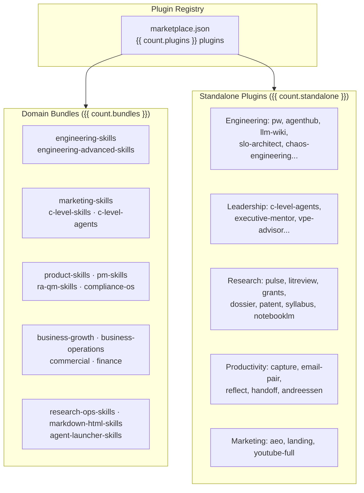

<div class="skills-hero" markdown>

# Plugins & Marketplace

**{{ count.plugins }} installable plugins** — {{ count.bundles }} domain bundles and {{ count.standalone }} standalone packages, distributed through the Claude Code plugin registry and ClawHub.

<p class="skills-hero-sub">Install an entire skill domain or a single tool with one command. Compatible with Claude Code, OpenAI Codex, Gemini CLI, and OpenClaw.</p>

</div>

---

## At a Glance

<div class="grid cards" markdown>

-   :material-puzzle-outline:{ .lg .middle } **{{ count.plugins }} Plugins**

    ---

    {{ count.bundles }} domain bundles + {{ count.standalone }} standalone packages

-   :material-domain:{ .lg .middle } **{{ count.domains }} Domains**

    ---

    Engineering, marketing, product, C-level, compliance, commercial, operations, research, finance, productivity, and more

-   :material-toolbox-outline:{ .lg .middle } **{{ count.skills }} Skills**

    ---

    Every skill in the library is installable through a plugin

-   :material-sync:{ .lg .middle } **4 Platforms**

    ---

    Claude Code, OpenAI Codex, Gemini CLI, OpenClaw — single repo, all platforms

</div>

---

## Quick Install

=== "Claude Code"

    ```bash
    # Add the marketplace
    /plugin marketplace add alirezarezvani/claude-skills

    # Install a domain bundle
    /plugin install engineering-skills@claude-code-skills

    # Or install a standalone plugin
    /plugin install research-orchestrator@claude-code-skills
    ```

=== "OpenAI Codex"

    ```bash
    git clone https://github.com/alirezarezvani/claude-skills.git
    cd claude-skills
    ./scripts/codex-install.sh --category engineering   # no arguments lists the categories
    ```

=== "Gemini CLI"

    ```bash
    git clone https://github.com/alirezarezvani/claude-skills.git
    cd claude-skills
    python3 scripts/sync-gemini-skills.py --verbose
    ```

=== "OpenClaw"

    ```bash
    curl -sL https://raw.githubusercontent.com/alirezarezvani/claude-skills/main/scripts/openclaw-install.sh | bash
    ```

---

## Plugin Architecture



---

## Domain Bundles

Domain bundles install an entire skill domain — every skill, Python tool, reference doc, and template in that folder. Use these when you want comprehensive coverage for a functional area.

| Bundle | Skills | What you get | Browse |
|---|:-:|---|---|
| `engineering-skills` | {{ count.in.engineering-team }} | Full engineering team: architecture, frontend, backend, QA, DevOps, SecOps, AI/ML, data, Playwright Pro, self-improving agent | [:octicons-arrow-right-24:](../skills/engineering-team/index.md) |
| `engineering-advanced-skills` | {{ count.in.engineering }} | Agent designer, RAG architect, MCP server builder, CI/CD, SLO architect, chaos engineering, security auditing, tech debt | [:octicons-arrow-right-24:](../skills/engineering/index.md) |
| `product-skills` | {{ count.in.product-team }} | PM toolkit (RICE, PRDs), agile PO, UX research, discovery, analytics, SaaS scaffolder, Apple HIG expert | [:octicons-arrow-right-24:](../skills/product-team/index.md) |
| `marketing-skills` | {{ count.in.marketing-skill }} | Content, SEO, AEO, CRO, paid channels, growth, intelligence, sales enablement — 8 specialist pods | [:octicons-arrow-right-24:](../skills/marketing-skill/index.md) |
| `c-level-skills` | {{ count.in.c-level-advisor }} | Full C-suite advisors, founder-mode boardroom, decision logger, scenario war room, M&A playbook | [:octicons-arrow-right-24:](../skills/c-level-advisor/index.md) |
| `ra-qm-skills` | {{ count.in.ra-qm-team }} | ISO 13485, MDR 2017/745, FDA 510(k)/PMA, ISO 27001, GDPR, CAPA, ISO 14971 risk management | [:octicons-arrow-right-24:](../skills/ra-qm-team/index.md) |
| `compliance-os` | {{ count.in.compliance-os }} | Audit-prep orchestrator: readiness and evidence checklists for ISO 13485, ISO 27001, SOC 2, GDPR, FDA QSR, EU AI Act, ISO 42001 | [:octicons-arrow-right-24:](../skills/compliance-os/index.md) |
| `pm-skills` | {{ count.in.project-management }} | Senior PM, scrum master, Jira/Confluence experts, Atlassian admin with bundled remote MCP | [:octicons-arrow-right-24:](../skills/project-management/index.md) |
| `business-growth-skills` | {{ count.in.business-growth }} | Customer success, sales engineering, revenue operations, contract & proposal writer | [:octicons-arrow-right-24:](../skills/business-growth/index.md) |
| `business-operations-skills` | {{ count.in.business-operations }} | Process mapping, vendor management, capacity planning, internal comms, knowledge ops, procurement | [:octicons-arrow-right-24:](../skills/business-operations/index.md) |
| `commercial-skills` | {{ count.in.commercial }} | Pricing strategy, deal desk, partnerships, channel economics, commercial policy, RFP response, forecasting | [:octicons-arrow-right-24:](../skills/commercial/index.md) |
| `finance-skills` | {{ count.in.finance }} | Financial analyst (DCF, ratios, budgets), SaaS metrics coach, business investment advisor | [:octicons-arrow-right-24:](../skills/finance/index.md) |
| `research-ops-skills` | {{ count.in.research-ops }} | Clinical study design, R&D program finance, market sizing/surveys, product research synthesis | [:octicons-arrow-right-24:](../skills/research-ops/index.md) |
| `c-level-agents` | {{ count.in.c-level-agents }} | Founder-mode executive team: per-role forcing-question reviews, boardroom, decision log, execute and post-mortem | [:octicons-arrow-right-24:](../skills/c-level-agents/index.md) |
| `agent-launcher-skills` | {{ count.in.agent-launcher }} | Build and launch Claude Managed Agents: interview, BYOK launch, bounded grade-iterate loop, scheduled runs | [:octicons-arrow-right-24:](../skills/agent-launcher/index.md) |
| `markdown-html-skills` | {{ count.in.markdown-html }} | Markdown-to-HTML converters: branded long-form docs, two-column code reviews, keyboard-navigable slide decks | [:octicons-arrow-right-24:](../skills/markdown-html/index.md) |

Install any bundle with:

```bash
/plugin install <bundle-name>@claude-code-skills
```

---

## Standalone Highlights

Standalone plugins install a single skill or toolkit. Use these when you need one specific capability without the full domain bundle.

### Research (8 plugins)

| Plugin | What it does |
|---|---|
| `research-orchestrator` | **Hybrid router + fallback** — classifies your question and routes to a specialist, or runs its own 8-step research workflow |
| `pulse` | Multi-source recency research (Reddit / HN / X / web) with sentiment |
| `litreview` | Academic literature review with PICO/SPIDER frameworks |
| `grants` | NIH grant-funding intelligence |
| `dossier` | Decision-grade entity research |
| `patent` | Patent prior-art and IP landscape |
| `syllabus` | Course supplementary reading lists (bundled DOCX generator) |
| `notebooklm` | Google NotebookLM browser automation |

### Productivity (5 plugins)

| Plugin | What it does |
|---|---|
| `capture-skill` | Brain-dump-to-action workspace |
| `email-pair` | Paired inbox-setup + inbox-triage with a 7-file knowledge-base contract |
| `reflect-skill` | Light-prompt reflection journal |
| `handoff-productivity` | Session-handoff notes with redaction linting and auto-load hooks |
| `andreessen` | Market-first decision pressure-testing in Marc Andreessen mode |

### Engineering favorites

`pw` (Playwright Pro), `self-improving-agent`, `agenthub`, `autoresearch-agent`, `llm-wiki`, `slo-architect`, `chaos-engineering`, `kubernetes-operator`, `feature-flags-architect`, `karpathy-coder`, `write-a-skill`, `security-guidance`, `universal-scraping-architect` — browse them all in [Engineering — Advanced](../skills/engineering/index.md).

---

## Plugin Structure

Every plugin follows the same minimal schema for maximum portability:

```json
{
  "name": "plugin-name",
  "description": "What it does",
  "version": "2.10.0",
  "author": { "name": "Author Name" },
  "homepage": "https://...",
  "repository": "https://...",
  "license": "MIT",
  "skills": ["./skills/<name>"]
}
```

**No extension fields of any kind** — Claude Code's manifest validator rejects the entire `plugin.json` on any unrecognized key (issue #954), and `scripts/check_plugin_json.py` hard-fails manifests carrying extras in CI. Authoring metadata lives in a sibling file the validator never reads, `.claude-plugin/authoring-notes.json`, holding at most two keys:

- **`source`** (object) — provenance metadata for Path-B megaprompt-derived skills (productivity, marketing, research).
- **`attribution`** (object) — credit metadata for skills derived from external MIT-licensed work (`caveman`, `grill-me`, `grill-with-docs`, `skillopt-sleep`, `book-to-skill`, and others). Upstream credit must also remain in the plugin's `README.md`/`LICENSE`.

!!! info "ClawHub Registry"
    Plugins are distributed via [ClawHub](https://clawhub.com) as the public registry. The `cs-` prefix is used only when a slug is already taken by another publisher — repo folder names remain unchanged.

---

## Compatibility Matrix

| Platform | Bundle Install | Standalone Install | Slash Commands | Agents |
|----------|:-:|:-:|:-:|:-:|
| **Claude Code** | :material-check: | :material-check: | :material-check: | :material-check: |
| **OpenAI Codex** | :material-check: | :material-check: | :material-close: | :material-close: |
| **Gemini CLI** | :material-check: | :material-check: | :material-close: | :material-close: |
| **OpenClaw** | :material-check: | :material-check: | :material-close: | :material-close: |

!!! tip "Full feature support"
    Slash commands (like `/cs-research`, `/pw:generate`) and agent spawning (like `cs-research`) are Claude Code features. On other platforms the underlying skills and Python tools work — just without the command/agent wrappers.

---

## All {{ count.plugins }} Plugins at a Glance

Generated from `.claude-plugin/marketplace.json` at build time, so this list always matches what you can install.

{{ plugin_table }}

---

## FAQ

??? question "What's the difference between a bundle and a standalone plugin?"
    **Bundles** install all skills in a domain (for example, `marketing-skills` installs every marketing skill). **Standalone** plugins install a single skill or toolkit (for example, `pulse` installs just the recency-research skill). Standalone plugins are subsets of their parent bundle when applicable — installing both is safe but redundant.

??? question "What is the research orchestrator?"
    `research-orchestrator` is a **hybrid router + fallback** that classifies any research question deterministically and either delegates to one of six specialists (pulse, litreview, grants, dossier, patent, syllabus, notebooklm) at ≥2-signal confidence, or runs its own 8-step plan-decompose-search-synthesize-cite workflow when no specialist matches. Routing transparency is mandatory — it never delegates silently.

??? question "Can I install multiple plugins?"
    Yes. Plugins are designed to coexist without conflicts. Each skill is self-contained with no cross-dependencies.

??? question "Do plugins require API keys or paid services?"
    No. All Python tools use the standard library only. Some skills reference external services (AWS, Google Workspace, Stripe, NIH RePORTER, Reddit/HN APIs) but follow a BYOK (bring-your-own-key) pattern — you use your own accounts.

??? question "How do I update plugins?"
    Refresh the marketplace with `/plugin marketplace update claude-code-skills`, then run `/plugin update <name>@claude-code-skills` (or `claude plugin update <name>@claude-code-skills` from a shell). Each changed plugin gets a new version, which is what makes the update reach existing installs.

??? question "What is ClawHub?"
    [ClawHub](https://clawhub.com) is the public registry for Claude Code plugins — think of it as npm for AI agent skills. The `cs-` prefix is used only when a plugin slug conflicts with another publisher.

??? question "Can I use skills without installing anything?"
    Yes. There are [6 Custom GPTs for ChatGPT](../custom-gpts.md) that package Agent Skills into a conversational interface — no installation, no API keys. Just click and chat.
