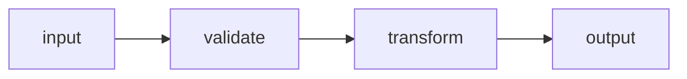

# Component Syntax and Limits

Every component below is native to common Markdown renderers. Keep the count low and the meaning
high.

## Component Selection

| Component | Use when | Skip when |
|---|---|---|
| Badge row (six or fewer) | License, language/runtime, version, real status | The entity does not exist |
| Mermaid | Flow, funnel, decision path (seven nodes or fewer) | Full architecture panorama |
| Native callouts (`> [!NOTE]`) | Install note, real evidence, risk | Decoration |
| Collapsible `<details>` | Long command reference, artifact layout, FAQ | The core value |
| Comparison table | "Before vs after", "it is / it is not" | Prose would be shorter |
| Explicit anchors | Non-ASCII or emoji headings | Short English headings |
| Banner image | Collection or commercial repo with real assets | Single tool without design assets |
| Table of contents | README longer than about 300 lines | Short documents |

## Anti-Patterns

- **Banner on a single-tool repo.** It reads as compensating.
- **More than six badges**, or badges for things that do not exist.
- **Placeholder images or fake screenshots.** Remove them or ship a real one.
- **Mermaid with more than seven nodes.** The diagram stops being scannable.
- **Tables wider than five columns.** They break on a phone.
- **Anchors that rely on auto-generated slugs** for non-ASCII headings; they will be wrong.
- **Hiding the value proposition inside `<details>`.**
- **Rewriting a README that is already accurate and scannable.**
- **Keeping stale claims** (old version, removed feature) because they look impressive.

## Badge row

```markdown
[](LICENSE)
[](https://www.python.org/)
[](CHANGELOG.md)
```

Rules: six badges maximum; every badge must point to a real entity or file; no badge for a service
the project does not use.

## Native callouts

```markdown
> [!NOTE]
> Operational detail worth reading before the first run.

> [!TIP]
> A real credential: benchmark, adoption, or runtime measurement.

> [!IMPORTANT]
> Behavior that changes the result if ignored.

> [!WARNING]
> Risk, limitation, or destructive operation.

> [!CAUTION]
> Data loss or irreversible step.
```

Callouts are free to render and cheap to overuse. One to three per README.

## Mermaid

````markdown

````

Rules: seven nodes or fewer; flow, funnel, or decision path only; no full architecture panorama.
The gate counts node definitions and fails above the configured maximum.

## Explicit anchors

Auto-generated anchors are unreliable for non-ASCII headings and emoji. Put the anchor on its own
line before the heading:

```markdown
<a id="install"></a>

## 安装
```

Then link with `[安装](#install)`.

## Collapsible sections

```markdown
<details>
<summary><b>Full command reference</b></summary>

| Command | Purpose |
|---|---|
| `tool run` | Execute the pipeline |

</details>
```

Use for reference material only. Never hide the value proposition or the install command.

## Tables

- Five columns maximum; split wider tables into two.
- Prefer a table over a paragraph when comparing three or more items.
- Left-align text, right-align numbers.
- Do not use a table for two short facts; prose is shorter.

## Images

- Use a relative path to a real file in the repository; the gate fails on missing targets.
- A screenshot must show the current UI; a stale screenshot is worse than none.
- No placeholder services, fake dashboards, or "image coming soon".

## Limits enforced by the gate

| Check | Default |
|---|---|
| Badges | 6 |
| Mermaid nodes | 7 |
| Table columns | 5 |
| Install command position | first 40 lines |

Adjust with `--max-badges`, `--max-mermaid-nodes`, `--max-table-cols`, `--first-screen-lines`.
